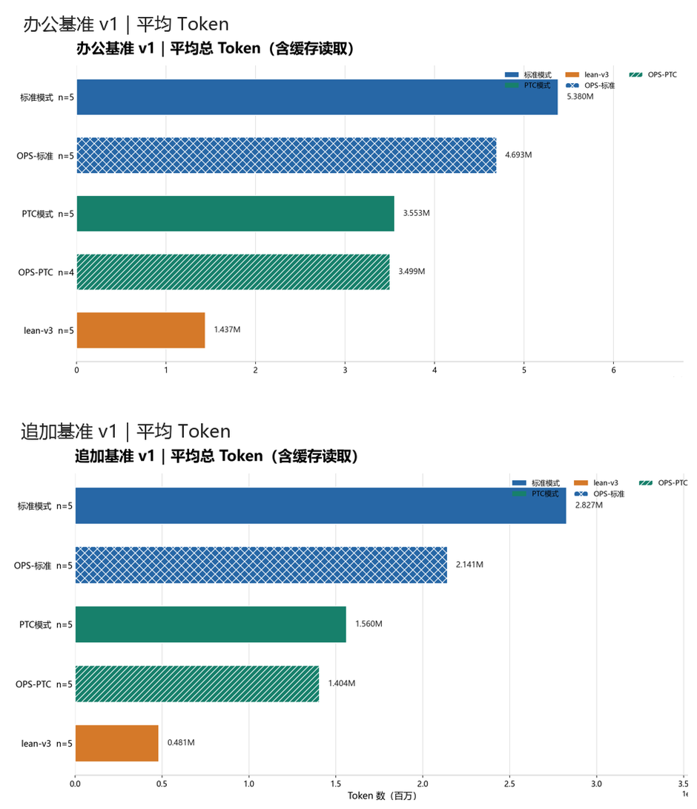

<p align="center"><strong>dsh-flash-presets</strong></p>

<p align="center"><a href="README.md">中文</a> | <strong>English</strong></p>

<p align="center">
  <a href="https://github.com/LarryE135/dsh-flash-presets/stargazers"></a>
  <a href="https://www.npmjs.com/package/dsh-flash-presets"></a>
  <a href="https://www.npmjs.com/package/dsh-flash-presets"></a>
</p>

# dsh-flash-presets

Agent presets for [DeepSeek Harness](https://github.com/deepseek-ai/deepseek-harness) (DSH), tuned for DeepSeek V4.1 Flash.

The idea is simple: compact the context earlier, keep only the head and tail of oversized tool output, leave unused tools out of the system prompt, and fold scattered tool calls into a single `run_code` program. None of this makes the model smarter. It changes how much a session reads, how much it wanders, and when it stops.

Everything ships as a DSH bundle (`dsh.bundle`). It inserts preset rows into a profile and doesn't touch the host source. **Three things do apply to the whole profile at runtime**: the resident PTC runtime (the `ptc-runtime` override in the patch, which affects **every** preset in that profile — the only way to switch it off is to remove this plugin card), the `glob` / `grep` concurrency marks (`DSH_FLASH_PRESETS_CONCURRENCY=0` disables them), and legacy preset-id resolution (`DSH_FLASH_PRESETS_ALIAS=0` disables that).

> Current version: 0.3.0 (2026-11-07) · presets v3 / v3 balance · plan mode plan-mode v1 (1.0.0) · requires DSH `>=0.2.1-rc.5 <0.2.3-0` (an `engines` gate: installs are refused outside it, and at load time an out-of-range DSH skips this plugin — `dsh plugin allow-version` can override at your own risk; the script install doesn't go through this gate), tested on 0.2.1-rc.5 and 0.2.2-rc.1
>
> When installing from npm, pin the version: `dsh-flash-presets@0.3.0` (`npm view dsh-flash-presets version`). Later commits on `main` fixed CI and the shipped docs **without a version bump and without a new Release** — 0.3.0 is still the published identity. **Do not install 0.2.5** — it cannot start a session on DSH 0.2.2-rc.1 (#19).

## Who it's for, and who it isn't

**A good fit for**

- Tasks with a clear goal and a way to check the result: changing code, running scripts, cleaning data, producing a file in a fixed format.
- Long sessions. DSH compacts at 80% of the context window by default, which most sessions never reach. These presets compact at 25%, so long sessions stay within bounds.
- Anyone who watches their token bill and would rather not repeat the same instructions in every message.

**Not a good fit for**

- Problems clearly beyond the model, such as competition-level tasks where the goal is partial credit. Standard mode holds up better there; see [measured evidence](docs/实测证据.md).
- Workflows that rely on the current date, installing plugins from inside a conversation, or scheduled tasks. Those capabilities are trimmed out (see [Differences from the official PTC preset](#differences-from-the-official-ptc-preset)).
- Models other than DeepSeek V4.1 Flash. The rules may still help, but nobody has checked.
- DSH below 0.2.1-rc.5 (including 0.2.1-rc.2 through rc.4). Use the matching older release instead (see [versions and compatibility](docs/版本与兼容性.md), in Chinese). The directory-style presets for DSH before 0.1.7 are no longer shipped as of 0.2.6.

## What it does

Four mechanisms, each acting at a different point in a session:

| Mechanism | When it acts | Setting | Effect |
|---|---|---|---|
| Turn compaction | When the stored context grows too large | `thresholdRatio: 0.25`, `retainTokens: 20000` (DSH default: 0.8) | History is replaced by a summary; only long sessions trigger it |
| Tool-output trimming | When a tool result enters the context | first 4096 / last 1024 characters | Oversized output keeps only its two ends |
| Disabled plugins | When the system prompt is assembled | 6 plugins set to `disabled: true` | Their tool schemas never reach the prompt — a fixed saving |
| Behavioral rules | At every step the model takes | persona rules (13 in lean-v3, 3 in balance) | Nudges the model to read less, batch calls, and edit incrementally |

Two more things come with the bundle:

- Tools are presented through PTC (`tool-presentation: ptc`), and the PTC runtime stays resident for the whole session (`ptc-runtime: persistent-in-memory`). Measured: the fixed startup cost per program dropped from 108 ms to about 0 (per the cost model), and nested tool calls from 44 ms to 15 ms ([benchmark notes](https://github.com/LarryE135/dsh-flash-presets/blob/main/docs/压测-run_code开销.md), in Chinese). The gain grows linearly with the number of calls inside a program; a short task that runs a single command will barely notice.
- The plugin marks `glob` and `grep` as safe to run concurrently, so several searches in the same turn can execute in parallel (plugin-manager installs of web / desktop only; the script install doesn't have it; `DSH_FLASH_PRESETS_CONCURRENCY=0` disables it).

For the reasoning behind each setting, with source line references, see the [four mechanisms write-up](docs/技术文档-省token四机制.md) (Chinese).

## Presets: lean-v3 + balance (the package ships exactly these two)

| Preset | id | Rules | Compaction | Use it when |
|---|---|---:|---|---|
| 精简·PTC v3 (lean-v3) | `flash-lean-ptc-v3` | 13 | 0.25 / 20k | **Default.** The most token-efficient option, right for most everyday work |
| 精简·PTC v3 balance | `flash-lean-ptc-v3-balance` | 3 | 0.25 / 20k | Weaker constraints; for work where the model should have more room |

Both share the same compaction/trimming framework and plugin set; only the persona rule text differs.

**ids that are not shipped** (add a row to your own profile patch if you need one):

- `flash-lean-ptc-v1` (14 rules / 0.3·50k) and `flash-lean-ptc-v2` (12 rules / 0.25·20k): the 0.2.5 rules.
  They still **resolve** to `flash-lean-ptc-v3` through the alias layer (opening old sessions wins over rule
  fidelity); they carry `rulesDiffer: true` and print a warning on first hit. Add a row to your own profile patch
  if you want the original rules. Source files: tag `v0.2.5`.
- `flash-lean-ptc-v3-lite` (0.2.6–0.2.8) and the older `flash-lean` / `flash-lean-ptc`: identical (or superseded)
  rules, resolved to `flash-lean-ptc-v3` by the runtime alias layer — no card needed.

Lite's 13 rules fall into five groups: budget (count turns, not steps; aim for 20 or fewer, and stop to re-plan past roughly 60), sequencing (think briefly, run one cheap probe, and for submission tasks ship the smallest working artifact first), verification (one consolidated acceptance pass, then deliver — no extra random or stress rounds), tools and output (read files with read/glob/grep, batch calls, edit incrementally), and scope (answer in the user's language, stay in scope, keep secrets out of the session, switch approach after two failures).

Balance keeps only the three rules the harness can't enforce on its own: respect the user's language and scope, never put secrets into the session, and after two failed attempts change approach and report the exact command and output.

Does the number of rules matter? Across three task sets we tested up to four arms — 0, 3, 7 and 13 rules (all four on the algorithm bed; 0/3/13 and 3/13 on the other two), n = 5–15 — and found no measurable difference in either quality or tokens ([measured evidence](docs/实测证据.md), "三床 × 四臂"). At that sample size, differences smaller than about 2× are undetectable, so the honest reading is "no difference observed", not "no difference". The savings come mainly from the first three mechanisms above and from PTC, not from the wording of the rules.

> A naming note for the evidence files: in the 2026-11-04 experiments, "v3" means the 13-rule preset (today's `flash-lean-ptc-v3`, shown as 精简·PTC v3（lean-v3）) and "lite" means the 3-rule preset (today's `flash-lean-ptc-v3-balance`). Display names changed in 0.2.6 and again in 0.2.9; **ids never changed**.

## Measurements

Every number below comes with its conditions and sample size. The experiments use different setups, so don't compare across tables.

### Office benchmark

Two synthetic suites of everyday office data-processing tasks: [Office benchmark v1](https://github.com/LarryE135/dsh-flash-presets/tree/main/benchmarks/office/base-v1) (8 tasks) and [Office addendum v1](https://github.com/LarryE135/dsh-flash-presets/tree/main/benchmarks/office/addendum-v1) (5 tasks). The table shows the mean tokens per configuration, including cache reads, in millions. OPS refers to [dsh-ops](https://github.com/T-Auto/dsh-ops).

<!-- bench-table:begin（本块由 scripts/render-bench-table.mjs 生成，勿手改）-->
| Setup | Office benchmark v1 | vs standard | Office addendum v1 | vs standard |
|---|---:|---:|---:|---:|
| Standard mode | 5.380 M(n=5) | — | 2.827 M(n=5) | — |
| OPS + standard | 4.693 M(n=5) | −12.8% | 2.141 M(n=5) | −24.3% |
| PTC mode | 3.553 M(n=5) | −34.0% | 1.560 M(n=5) | −44.8% |
| OPS + PTC | 3.499 M(n=4) | −35.0% | 1.404 M(n=5) | −50.3% |
| lean-v3 | 1.437 M(n=5) | −73.3% | 0.481 M(n=5) | −83.0% |
<!-- bench-table:end -->



How to read it:

- `lean-v3` is the 13-rule preset as it stood in 0.2.5; its rules are identical to today's `flash-lean-ptc-v3` (lean-v3).
- "vs standard" also includes the gain from switching to PTC tools. To isolate the preset, compare against PTC mode instead: roughly −59.6% and −69.2% on the two suites (computed from the table).
- Tokens only. The run records mark every run as fully correct, so accuracy isn't broken out (per-task scores aren't in this repository). Tasks were written and graded by the same model (`GPT-6.1-Sol`), but the answering stage had no access to the ground truth or the grader.
- `OPS + PTC` has only 4 valid runs on Office benchmark v1. The two suites contain different tasks and are not pooled into one ranking.
- Scoring rules are public in [`benchmarks/office/grading/`](https://github.com/LarryE135/dsh-flash-presets/tree/main/benchmarks/office/grading); ground truth and graders live in a private repository.

## Install

### With the plugin manager (recommended)

The plugin manager installs the whole plugin card: both presets, the plan-mode component, the resident PTC runtime, and the legacy-id compatibility layer.

```console
# 0.2.9 from npm, pinned to the version
dsh plugin --profile web add dsh-flash-presets@0.3.0
# or the same release as a tag, if you'd rather not use npm
dsh plugin --profile web add github:LarryE135/dsh-flash-presets#v0.3.0
```

`--profile` is normally `web` or `desktop` (presets don't activate under `headless`, and `acp` is untested — see [Known limitations](#known-limitations)). Entering the package name or GitHub address under Plugins → Add plugin in the GUI does the same thing.

Presets directly shape agent behavior, so pin a version when you need reproducible results. With a bare npm name the manager records a caret range, and any later pnpm operation may move you to the newest 0.2.x; a `github:` install records a git ref (`#v<version>`) instead and won't drift.

### Offline, or with the install script

Download and unpack the archive from [Releases](https://github.com/LarryE135/dsh-flash-presets/releases), or clone the tag:

```bash
git clone --depth 1 -b v0.3.0 https://github.com/LarryE135/dsh-flash-presets.git
cd dsh-flash-presets
bash scripts/install.sh --profile web                  # Windows: scripts\install.ps1 -Profile web
```

The script writes a single managed block containing the two preset rows into the profile patch. It backs up the file first, and re-running it never creates a second block. The plan-mode component, the legacy-id layer, and the composition self-check are part of the plugin itself and only load when installed through the plugin manager. The plan-mode component, the legacy-id layer, the composition self-check and the `glob`/`grep` concurrency marks are all part of the plugin, so only a plugin-manager install brings them. With `--with-runtime` (formerly `--with-plan-mode`; `-WithRuntime` in PowerShell) the script also writes a profile-level `ptc-runtime: persistent-in-memory` — that one applies to **every** preset in the profile, and `--uninstall` removes it too.

The two paths are either/or: if the script already wrote the preset rows and you want the plugin card instead, run `--uninstall` first. Having both does not error out (`--dump-config` still exits 0), but every preset shows up twice in the picker (8 preset rows measured in the patch). `agent-preset/invalid` is the error code for a **preset definition that fails to parse**, not for duplicates.

### Restart after installing

Presets and runtime settings are read once, at process start.

- `web` profile: reload the page.
- `desktop`: quit the host completely and start it again. The classic symptom of skipping this is "the plugin is installed, but the `run_code` speedup isn't there".
- `headless` / `acp`: presets don't activate there anyway (`headless` measured, `acp` untested), so there is nothing to restart.

### Check the installation

```bash
dsh --profile web --dump-config | grep -c 'id: preset-'             # 6 (4 built-in + 2 from this package, with no other preset packages)
dsh --profile web --dump-config | grep -c 'persistent-in-memory'    # 1
dsh --profile web --dump-config | grep -c 'plan-mode-ui'            # 1
node scripts/doctor.mjs --profile web                                # version, duplicate rows, !!js, YAML parsing in one pass
```

Those `node scripts/...` paths assume you're in the repository (or the unpacked release archive). With a plugin-manager install the scripts live inside the profile: `node ~/.dsh/profiles/web/node_modules/dsh-flash-presets/scripts/doctor.mjs --profile web`.

### Update and uninstall

To update, run the same `add` again, or `remove` and then `add`.

To uninstall:

```console
dsh plugin --profile web remove dsh-flash-presets     # if installed with the plugin manager
bash scripts/install.sh --uninstall --profile web     # if installed with the script (Windows: scripts\install.ps1 -Uninstall)
```

pnpm leaves one line for this package in the profile's `pnpm-workspace.yaml`, and `remove` doesn't clear it. It has no effect on the composed configuration.

### Upgrading from an older release

- **Preset ids no longer change.** The 13-rule preset is `flash-lean-ptc-v3`; the 3-rule preset is `flash-lean-ptc-v3-balance`. 0.2.7–0.2.8 renamed the first one to `flash-lean-ptc-v3-lite`; 0.2.9 reverts that and will not rename ids again — DSH persists the preset id inside the session log, so renaming it is what makes old sessions fail to open. Rule text may evolve; identifiers stay put.
- Old sessions still open, and none of them get rewritten: `flash-lean-ptc-v3-lite` (0.2.6–0.2.8) has identical rules and is aliased to `flash-lean-ptc-v3`; older `flash-lean` / `flash-lean-ptc` are aliased too, and `flash-lean-ptc-v1` / `-v2` are aliased as well (0.2.8 already aliased them and 0.2.9 keeps that promise); their rules differ from v3, so the first hit logs a warning — add a row to your profile patch if you want the old rules, which is what this machine does for `v2`. Ids used only in local experiments can be added through `DSH_FLASH_PRESETS_ALIAS_EXTRA`. The layer steps in only when resolution fails and never rewrites a session file. The mapping is in [`presets/legacy-preset-map.json`](presets/legacy-preset-map.json); the design is described in [preset id contract and upgrades](docs/预设-id-契约与升级.md) (Chinese).
- **The install never touches sessions**: `install.sh` / `install.ps1` and plugin startup do not scan or rewrite `sessions/`. As of 0.2.9 **no code in this package writes a session file at all** (the start-up self-heal `lib/compat-heal.js` is gone: it rewrote the header without invalidating DSH's projection cache, so it barely worked and left a stale lock behind). CI asserts that a session directory is byte-identical after an install and an uninstall.
- **Desktop app / plugin card**: whether old sessions open depends on the bundle carrying a `flash-presets-alias` row (a standalone plugin that injects only `agentPresets`). Cards older than 0.2.9 lack it — reinstall with `dsh plugin --profile desktop add github:LarryE135/dsh-flash-presets#v0.3.0`. `node scripts/doctor.mjs --profile desktop` tells you whether the row is there.
- **Script install (`install.sh` / `install.ps1`)**: this path has no alias layer. If the patch mentioned `flash-lean-ptc-v3-lite` before the upgrade, `merge-presets` keeps one extra compatibility row (`order: 99`, labelled "do not pick"), otherwise those sessions would be not-found. A profile that already carries the plugin card is refused (`exit 4`) — pass `--force` to stack them anyway.
- If you installed the standalone `dsh-plan-mode-ui` package, run `dsh plugin remove dsh-plan-mode-ui` first, or plan mode will be injected twice.
- If the profile's `selectedDefault` points at `flash-lean-ptc-v3-lite`, set it to `flash-lean-ptc-v3` (the old value still resolves through the compatibility layer).

## Plan mode (optional component)

The same plugin card carries a plan-mode component, plan-mode v1 (1.0.0). Within a single turn, the agent writes a plan, waits for your approval, then executes it, and writes the measured acceptance results back to the card at the end. The two halves divide the work cleanly: the presets govern how each turn spends its budget; plan mode makes the turn think before it acts.

- The control sits to the left of the input box, with off / light / full levels independent of the preset.
- Light is the recommended default. In a comparison with n = 3 and 7 acceptance checks, both levels passed 3/3; full used about 17% more tokens (median 40.2k vs 34.3k) and about 33% more time (196 s vs 147 s) ([changelog](docs/CHANGELOG.md), Chinese).
- If you don't want it, switch the component off on the card. The presets behave exactly the same without it.

## Getting the most out of it

- **State the goal and how success is checked.** The sharper the criteria, the better the result; when the boundaries are fuzzy, pair it with plan or goal mode. The P15654 comparison is in [measured evidence](docs/实测证据.md).
- **Raise the output limit.** 120K or more is recommended, 384K if you can, so long reasoning isn't cut off.
- **On Windows**, install PowerShell 7 (the MSI build) or Git Bash first.
- **Give long-thinking models one problem per session.** Handed several at once, a model may lay out every plan in a single response and get cut off upstream before it ever acts ([measured evidence](docs/实测证据.md), "跨模型").

## Troubleshooting

Run the checkup before guessing:

```bash
node scripts/doctor.mjs --profile web          # add --dump to also run dsh --dump-config
node scripts/diag-preset-load.mjs --profile desktop   # when a preset card in the GUI shows "failed to load"
```

| Symptom | Cause | Fix |
|---|---|---|
| A preset card shows "failed to load" | A plugin the preset references can't be resolved. Most often a hand-edited preset still lists `.../dsh-tool-subagent-control/list-agents`, a subpath DSH 0.2.2-rc.1 removed | Locate it with `diag-preset-load.mjs` and delete that row |
| The compact / plan / goal slash commands disappear, and the next message fails with `tool executor is unavailable` | A plugin hot reload released the preset composition of an open session and didn't remount it | Restart DSH. The plugin checks every 2 minutes and logs the remedy; set `DSH_FLASH_PRESETS_SELFCHECK_HEAL=1` to remount automatically |
| Two or three presets with the same name | Bare rows from an old install sit next to the new managed block | Re-run the install script; it adopts and merges the old rows |
| `js-yaml` reports `unknown tag` | The file still contains `!!js` tags | `node scripts/doctor.mjs --fix` (back up first) |
| The presets don't appear at all | DSH is older than 0.2.1-rc.5, or the wrong profile was targeted | Upgrade DSH, or point `--profile` at the right one |
| The presets vanish after a DSH upgrade | DSH went past the `engines` ceiling `<0.2.3-0`, so the plugin is skipped at load time | Upgrade this package; `dsh plugin allow-version` can force it at your own risk |

The preset patch only defines the agent-side plugin set. It doesn't touch GUI pieces such as the workspace picker, the directory picker, or the terminal. If something unrelated to presets breaks after installing, please open an [issue](https://github.com/LarryE135/dsh-flash-presets/issues) with the doctor output and the browser console errors.

## Differences from the official PTC preset

| In the official preset, not here | What it means |
|---|---|
| `time-context` | The prompt carries no current date or time; state it yourself when a task needs it |
| `tool-schedule` | No tool for scheduled or recurring tasks |
| `tool-plugin-market` | No installing plugins from inside a conversation; use `dsh plugin` |

The presets also declare `tool-subagent-codex`, `tool-subagent-claude-code`, `workflow-ptc`, `tool-workflow`, `tool-ralph`, and the plugin-manager tools, all disabled. If you need any of these, the official preset is the easier choice.

## Known limitations

- Under the headless profile on DSH 0.2.2-rc.1, both presets and plan mode stay pending and never take effect (each run reports `3 entries did not activate`). Use the web or desktop profile. `acp` is completely unverified.
- macOS hasn't been verified on real hardware. The install script is written for bash 3.2 and runs in CI on all three platforms.
- The patch contains `!!js` tags that the DSH loader resolves; third-party YAML parsers report an unknown tag. The install script resolves them to plain values before writing to the profile.
- The `glob` / `grep` concurrency marks only exist in a plugin-manager install (`DSH_FLASH_PRESETS_CONCURRENCY=0` disables them); the script install never has them. Legacy-id resolution comes from the plugin too (`DSH_FLASH_PRESETS_ALIAS=0`).
- The plan-mode component also reads two environment variables: `DSH_PLAN_TODO_SYNC=off|remind|strict` (default `remind`) controls whether todo writes are reminded or required, and `DSH_PLAN_LAG_TURNS=<n>` (default 2) is how many turns behind the run may fall before a nudge; they mirror the `todoSync` / `lagTurns` plugin config keys.
- Development and testing centered on the public Luogu problem set and the office benchmark above. Other kinds of work have little data behind them.

## Development and checks

```console
npm run verify          # composition, YAML, preset structure, text lint, version consistency, benchmark leak guard, and more
npm run bench:office    # structure and integrity checks for the office benchmark (repo only; the npm package excludes benchmarks/)
bash scripts/selftest.sh
```

`cordis.patch.yml` is composed from `presets/*.patch.yml`; don't edit it by hand — CI asserts the two match. The measurement table in this README is generated from `docs/bench-office-results.json`. See [CONTRIBUTING](https://github.com/LarryE135/dsh-flash-presets/blob/main/CONTRIBUTING.md) for how to contribute.

## Version history

### v0.3.0 (2026-11-07)

- **Display names and descriptions only — no id, rule or behavior change**: `flash-lean-ptc-v3` now reads "the most token-efficient option, right for most everyday work"; `flash-lean-ptc-v3-balance` is shown as 精简·PTC v3 balance with the internal note dropped. DSH resolves presets by `config.id`; `config.name` is just picker text, so old sessions and old ids keep resolving.
- Also fixes two 0.2.9 bookkeeping errors (stale `publishedVersion`, shipped docs saying npm was unpublished).

### v0.2.9 (2026-11-07)

- **Preset ids are back to stable values.** The lite preset's id returns from `flash-lean-ptc-v3-lite` to `flash-lean-ptc-v3` (the identity it shipped with through 0.2.5) and will not be renamed again. The 0.2.7 rename is what broke old desktop sessions after upgrading: their logs record `flash-lean-ptc-v3`, and a compatibility layer can only patch the resolution step, not every other check. The fix is to stop moving the identifier and let only the rule text and descriptions evolve.
- The compatibility layer stays, pointing the other way: `flash-lean-ptc-v3-lite` (produced by 0.2.7–0.2.8) plus the older `flash-lean`, `flash-lean-ptc`, `-v1`, `-v2` all resolve to `flash-lean-ptc-v3`.
- No migration needed for anyone who did not install `--with-runtime`: install the new version and every old session opens.

### v0.2.8 (2026-11-06)

- Third-round audit fixes: the regression where `--with-runtime` followed by `--uninstall` left an empty patch file and the profile would not boot (uninstall now reverts the runtime block first, and the revert restores `[]`); Windows `-Uninstall` now removes the runtime override too.
- `tune-runtime` no longer silently ignores unknown arguments (`-Profile` used to apply the override to every profile); `doctor` checks only the two current presets in section 3, no longer suggests installing the bare package name in section 6, and exits 1 when it finds problems; `install.sh --help` no longer truncates its last line.
- `publish.sh` / `publish.ps1` drop the move-the-tag escape hatch (they refuse to run when the remote tag can't be queried, and archive by tag); `verify-versions` now checks the versions hard-coded in the installers, the marketplace entry, and both READMEs.
- npm skips 0.2.7 and goes straight to 0.2.8: 0.2.7 exists only as the GitHub tag `v0.2.7`.

### v0.2.7 (2026-11-06)

- Second-round audit fixes: installer wording and the `--with-runtime` rename, `--uninstall` now removes the runtime override, `doctor --sessions` no longer crashes, the alias table no longer carries `$comment`, the peer range covers 0.2.2-rc.1, and `NOTICE` carries the upstream MIT text.
- Docs now match the implementation: the top of this README states the two things that apply to the whole profile and how to switch them off; "12 historical ids" became 5; broken anchors and a dangling reference are gone; plan mode's "26% more expensive" is corrected to 17% (medians).
- CI gained a 0.2.2-rc.1 install matrix entry and a pack → unpack → run-user-scripts job, and `bundle-install` now compares exact ids instead of substrings.
### v0.2.6 (2026-11-06)

- Two presets remain: lite (13 rules, default) and balance (3 rules). v1, v2, and the experimental variants are no longer shipped.
- Plan mode moved back into the main package (plan-mode v1), on the same plugin card as the two presets.
- New runtime compatibility layer: the 5 ids this package ever published resolve to lite without rewriting session files.
- New composition self-check, a four-layer alignment audit (`npm run audit:align`), and read-only concurrency marks for `glob` / `grep`.
- Fixed: preset cards showed "failed to load" after DSH 0.2.2-rc.1 removed the `list-agents` subpath.

Earlier releases: 0.2.5 installed only v3 by default; 0.2.2 made the package installable from npm; 0.2.1 made v3 the main preset; 0.2.0 introduced the bundle format; 0.1.0 was the first release. Details are in the [changelog](docs/CHANGELOG.md) (Chinese) and on the [Releases](https://github.com/LarryE135/dsh-flash-presets/releases) page.

## Documentation (Chinese)

- [Measured evidence](docs/实测证据.md): every experiment, including the conclusions that didn't hold
- [Versions and compatibility](docs/版本与兼容性.md): version mapping and install regression
- [Preset id contract and upgrades](docs/预设-id-契约与升级.md)
- [The four token-saving mechanisms](docs/技术文档-省token四机制.md), [How the presets are implemented](docs/技术文档-精简预设实现.md)
- [Changelog](docs/CHANGELOG.md)

## License

[MIT](LICENSE)

## Maintainer

<table>
  <tbody>
    <tr>
      <td align="center" width="150"><a href="https://github.com/LarryE135"></a><br><a href="https://github.com/LarryE135"><b>LarryE135</b></a></td>
    </tr>
  </tbody>
</table>
