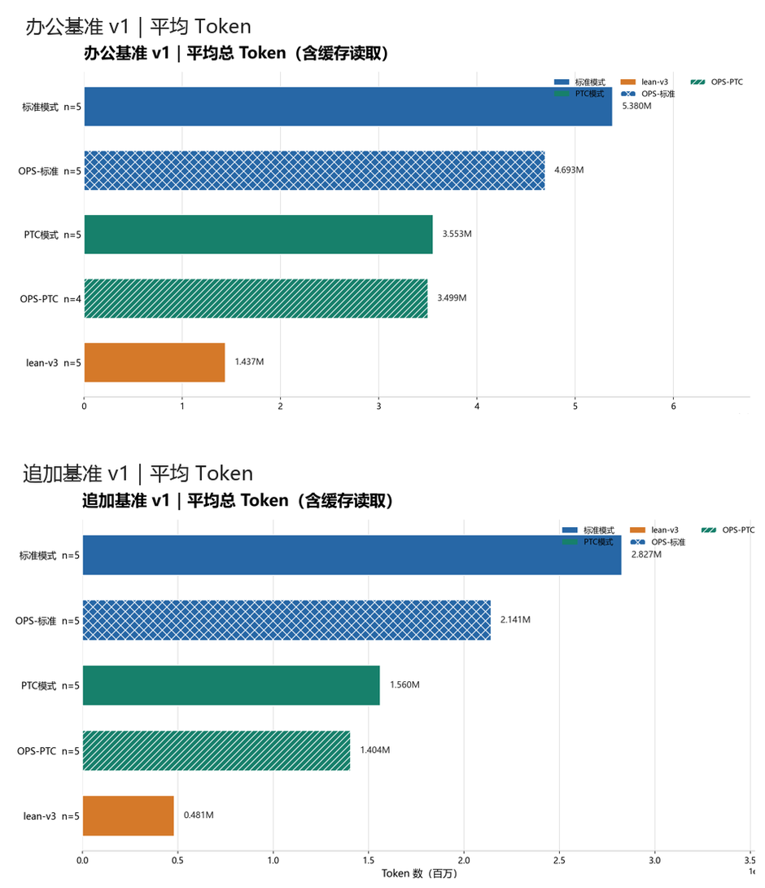

<p align="center"><strong>dsh-flash-presets</strong></p>

<p align="center"><strong>中文</strong> | <a href="README.en.md">English</a></p>

<p align="center">
  <a href="https://github.com/LarryE135/dsh-flash-presets/stargazers"></a>
  <a href="https://www.npmjs.com/package/dsh-flash-presets"></a>
  <a href="https://www.npmjs.com/package/dsh-flash-presets"></a>
</p>

# dsh-flash-presets

为 DeepSeek V4.1 Flash 调校的 [DeepSeek Harness](https://github.com/deepseek-ai/deepseek-harness)（DSH）agent 预设。

它做的事情很朴素：上下文更早压缩，过长的工具输出只留头尾，用不上的工具不进系统提示，零碎的工具调用尽量并进一段 `run_code`。模型不会因此变聪明；变的是一次会话读多少、绕多少、何时收尾。

整个包以 DSH 组合包（`dsh.bundle`）交付：向 profile 插入预设行，不改宿主代码，也不动共享工具注册表。

> 当前版本：v0.2.6（2026-11-06）· 预设 v3 lite / v3 balance · 计划模式 plan-mode v1（1.0.0）· 要求 DSH `>=0.2.1-rc.5 <0.2.3-0`（`engines` 硬闸，不满足会拒绝安装），实测 0.2.1-rc.5 与 0.2.2-rc.1
>
> npm 上的最新版仍是 0.2.5，它在 DSH 0.2.2-rc.1 上无法新建会话。0.2.6 发布到 npm 之前，请从 GitHub 或 Release 附件安装（见[安装](#安装)）。

## 适合谁，不适合什么

**适合**

- 目标清楚、有验收标准的任务：改代码、跑脚本、整理数据、按格式出交付物。
- 长会话。默认压缩阈值是上下文的 80%，多数会话根本触发不了；本预设改为 25%，长会话的上下文因此保持在可控范围。
- 在意 token 账单、又不想在每条消息里反复叮嘱模型的人。

**不适合**

- 明显超出模型能力的难题，比如竞赛级、以拿部分分为目标的题目。这类任务上标准模式更稳，数据见[不利的结果](#不利的结果)。
- 依赖当前日期、对话内安装插件或定时任务的工作流：这几项能力在预设里被裁掉了（见[与官方 PTC 预设的差异](#与官方-ptc-预设的差异)）。
- DeepSeek V4.1 Flash 以外的模型。规则可能仍然有用，但没有验证过。
- DSH 0.2.0 及更早版本。请改用对应的旧版本（见[版本与兼容性](docs/版本与兼容性.md)）；DSH 0.1.7 以前的目录式预设，0.2.6 已不再提供。

## 它做了什么

四个机制分别作用在会话的四个时刻，彼此不重叠：

| 机制 | 作用时刻 | 设置 | 效果 |
|---|---|---|---|
| 轮次压缩 | 上下文存量过大时 | `thresholdRatio: 0.25`，`retainTokens: 20000`（官方默认 0.8） | 历史换成摘要，长会话才触发 |
| 工具输出裁剪 | 工具结果进入上下文时 | 头 4096 / 尾 1024 字符 | 每条过长输出只留两端 |
| 关闭插件 | 组装系统提示时 | 6 个插件 `disabled: true` | 这些工具的 schema 不进提示，固定省一笔 |
| 行为纪律 | 模型每一步决策时 | persona 规则（lite 13 条，balance 3 条） | 引导少读、批量调用、增量改写 |

另外两项随包生效：

- 工具面使用 PTC（`tool-presentation: ptc`），PTC 运行时改为会话内常驻（`ptc-runtime: persistent-in-memory`）。实测每个 program 的固定启动成本从 108 ms 降到 0，嵌套工具调用从 44 ms 降到 15 ms（[压测记录](https://github.com/LarryE135/dsh-flash-presets/blob/main/docs/压测-run_code开销.md)）。收益随单个 program 内的调用次数线性增长，只跑一条命令的短任务几乎无感。
- 插件在运行时为 `glob` / `grep` 补上只读并发标记，同一轮里的多个搜索可以并行执行（仅 web / desktop profile，见[已知限制](#已知限制)）。

逐项原理与源码行号见[技术文档 · 省 token 的四套机制](docs/技术文档-省token四机制.md)。

## 两个预设

| 预设 | id | 规则 | 压缩 | 何时用 |
|---|---|---:|---|---|
| 轻量PTC-v3 lite（原lean-v3） | `flash-lean-ptc-v3-lite` | 13 | 0.25 / 20k | 默认。适合绝大多数日常工作 |
| 轻量PTC-v3 balance | `flash-lean-ptc-v3-balance` | 3 | 0.25 / 20k | 规则更少，留给模型更多发挥空间 |

两者共享同一套压缩、裁剪、插件与 PTC 配置，区别只在 persona 规则。

lite 的 13 条规则分五组：预算（按轮而不是按步计，目标 20 轮以内，超过约 60 轮就停下重新规划）、动手顺序（短判断加一次廉价探测，提交型任务先交最小可行产物）、验证（验收一次通过即交付，不追加随机测试与压测）、工具与输出（用 read/glob/grep 读文件，批量调用，增量改写）、交付与范围（按用户语言作答，守住范围，不把密钥写进会话，同一路子失败两次就换）。

balance 只保留引擎替代不了的三条：守住语言与范围、不写密钥、连败两次就换路子并报告确切的命令和输出。

规则条数该怎么选，我们测过：在三组任务上对比 0、3、7、13 条规则，n = 5–15，质量和 token 都没有测出可区分的差异（[实测证据](docs/实测证据.md)「三床 × 四臂」）。这个规模测不出小于约 2 倍的差异，所以结论是「没有观察到差异」，不是「没有差异」。省下的 token 主要来自上表里前三个机制和 PTC，而不是规则文本。

> 读实测记录时注意命名：2026-11-04 的那批实验里，「v3」指 13 条规则的版本（即现在的 lite），「lite」指 3 条规则的版本（即现在的 balance）。0.2.6 发布时做了这次改名。

## 实测

下面每组数字都标明了条件与样本量。不同实验之间口径不同，请不要跨表比较。

### 办公基准

两套虚构的日常办公数据处理任务：[办公基准 v1](https://github.com/LarryE135/dsh-flash-presets/tree/main/benchmarks/office/base-v1)（8 题）与[办公追加 v1](https://github.com/LarryE135/dsh-flash-presets/tree/main/benchmarks/office/addendum-v1)（5 题）。表中为每个配置的平均 token，含缓存读取，单位百万；OPS 指 [dsh-ops](https://github.com/T-Auto/dsh-ops)。

<!-- bench-table:begin（本块由 scripts/render-bench-table.mjs 生成，勿手改）-->
| 配置 | 办公基准 v1 | 相对标准模式 | 办公追加 v1 | 相对标准模式 |
|---|---:|---:|---:|---:|
| 标准模式 | 5.380 M（n=5） | — | 2.827 M（n=5） | — |
| OPS + 标准模式 | 4.693 M（n=5） | −12.8% | 2.141 M（n=5） | −24.3% |
| PTC 模式 | 3.553 M（n=5） | −34.0% | 1.560 M（n=5） | −44.8% |
| OPS + PTC | 3.499 M（n=4） | −35.0% | 1.404 M（n=5） | −50.3% |
| lean-v3 | 1.437 M（n=5） | −73.3% | 0.481 M（n=5） | −83.0% |
<!-- bench-table:end -->



怎么读这张表：

- `lean-v3` 是 0.2.5 时期的 13 条规则版，与现在的 lite 规则相同。
- 「相对标准模式」同时包含了 PTC 工具面的收益。只看预设本身，应与 PTC 模式比：两个套件上分别约为 −59.6% 与 −69.2%（由表中数字算出）。
- 表里只有 token。各配置在正确性上没有差异（全部运行均全对），因此不单列正确率。出题与评分使用同一个模型（`GPT-6.1-Sol`），但答题环节读不到真值与评分器。
- `OPS + PTC` 在办公基准 v1 上只有 4 次有效运行。两个套件任务不同，不合并排名。
- 评分规则公开在 [`benchmarks/office/grading/`](https://github.com/LarryE135/dsh-flash-presets/tree/main/benchmarks/office/grading)，真值与评分器放在私有仓库。

## 安装

### 用插件管理器（推荐）

插件管理器会装上整张插件卡：两个预设、计划模式组件、常驻 PTC 运行时，以及旧 id 兼容层。

```console
# 0.2.6，从 GitHub 按 tag 安装（锁死版本；npm 跟上之前用这条）
dsh plugin --profile web add github:LarryE135/dsh-flash-presets#v0.2.6
```

> npm 上的 0.2.5 在 DSH 0.2.2-rc.1 上无法新建会话（#19），请不要再安装它。0.2.6 发布到 npm 后，这里会换成 `dsh-flash-presets@0.2.6`。

`--profile` 通常取 `web` 或 `desktop`（`headless` / `acp` 下预设不会激活，见[已知偏差](#已知偏差)）。在 GUI 的「插件 → 添加插件」里填包名或 GitHub 地址，效果相同。

预设直接决定 agent 的行为，需要可复现时请写死版本号。不带版本号时，管理器写入的是 caret 范围，之后任何一次 pnpm 操作都可能把它升到 0.2.x 的最新版。

### 离线或用脚本安装

从 [Release](https://github.com/LarryE135/dsh-flash-presets/releases) 下载附件解压，或克隆对应的 tag：

```bash
git clone --depth 1 -b v0.2.6 https://github.com/LarryE135/dsh-flash-presets.git
cd dsh-flash-presets
bash scripts/install.sh --profile web                  # Windows：scripts\install.ps1 -Profile web
```

脚本只向 profile 补丁写入一个托管块，里面是两个预设行；写入前会备份原文件，重复运行不会产生第二份。计划模式组件、旧 id 兼容层和组合自检属于插件本体，只有通过插件管理器安装才会加载。加 `--with-plan-mode`（PowerShell 为 `-WithPlanMode`）时，脚本会额外把常驻 PTC 运行时写进该 profile。

### 装完要重启

预设和运行时配置都在进程启动时读取一次。

- `web` profile：刷新页面即可。
- `desktop`、`headless`、`acp`：完全退出宿主后再启动。不重启的典型表现是「插件已装，但 `run_code` 优化没有生效」。

### 确认装好了

```bash
dsh --profile web --dump-config | grep -c 'id: preset-'             # 6（内置 4 条 + 本包 2 条；未装其他预设包时）
dsh --profile web --dump-config | grep -c 'persistent-in-memory'    # 1
dsh --profile web --dump-config | grep -c 'plan-mode-ui'            # 1
node scripts/doctor.mjs --profile web                                # 版本、重复行、!!js、YAML 解析一次查完
```

### 更新与卸载

更新：重新执行同一条 `add`，或先 `remove` 再 `add`。

卸载：

```console
dsh plugin --profile web remove dsh-flash-presets     # 插件管理器安装的
bash scripts/install.sh --uninstall --profile web     # 脚本安装的（Windows：scripts\install.ps1 -Uninstall）
```

pnpm 会在该 profile 的 `pnpm-workspace.yaml` 里留下一行本包记录，`remove` 不会清掉它。这一行不影响配置合成。

### 从 0.2.5 升级

- 预设 id 变了：13 条规则版由 `flash-lean-ptc-v3` 改为 `flash-lean-ptc-v3-lite`，原来 3 条规则的 `flash-lean-ptc-v3-lite` 改名为 `flash-lean-ptc-v3-balance`。
- 旧会话照常打开：运行时兼容层把 12 个历史 id（包括 `flash-lean-ptc-v3`、`-v2` 等）解析到 lite。它只在解析失败时介入，不改写任何会话文件。映射表见 [`presets/legacy-preset-map.json`](presets/legacy-preset-map.json)，原理见[预设 id 契约与升级](docs/预设-id-契约与升级.md)。
- 装过独立包 `dsh-plan-mode-ui` 的，先 `dsh plugin remove dsh-plan-mode-ui`，否则计划模式会被注入两次。
- 如果 profile 的 `selectedDefault` 还指向旧 id，新建会话会报 `Unknown agent preset`，改成 `flash-lean-ptc-v3-lite` 即可。

## 计划模式（可选组件）

同一张插件卡里还有计划模式组件 plan-mode v1（1.0.0）：同一个回合里先写计划，经你批准后再执行，结束时把实测的验收数字写回卡片。它与预设各管一件事：预设管每一轮怎么花，计划模式管这个回合先想清楚再动手。

- 入口在输入框左侧，档位为 off / light / full，与预设设置相互独立。
- 默认推荐 light。在 n = 3、7 项验收的对比中，两档都是 3/3 全过，full 的 token 多约 26%、耗时多约 33%（[变更日志](docs/CHANGELOG.md)）。
- 不用时在卡片里关掉这个组件即可，预设行为不受影响。

## 用好它

- **先给目标和验收标准。** 标准越明确，效果越好；边界不清时配合 plan 或 goal 模式。上面 P15654 的例子说明了差别有多大。
- **把输出上限调高。** 建议 120K 以上，条件允许就设到 384K，避免长时间推理被截断。
- **Windows 用户**建议先装好 PowerShell 7（MSI 版）或 Git Bash。
- **长思考模型一题一会话。** 一次塞多道题，模型可能把全部计划铺进同一个响应，在动手之前就被上游断流（[实测证据](docs/实测证据.md)「跨模型」）。

## 排查

先跑一次体检，再下判断：

```bash
node scripts/doctor.mjs --profile web          # 加 --dump 顺带跑 dsh --dump-config
node scripts/diag-preset-load.mjs --profile desktop   # GUI 里预设卡片显示「加载失败」时用
```

| 症状 | 原因 | 处理 |
|---|---|---|
| 预设卡片显示「加载失败」 | 预设里引用的插件在本机解析不到。最常见的是自行改预设时写了 `.../dsh-tool-subagent-control/list-agents`，该子路径在 DSH 0.2.2-rc.1 已移除 | 用 `diag-preset-load.mjs` 定位，删掉那一行 |
| 斜杠菜单里「压缩 / 计划 / 目标」消失，下一句报 `tool executor is unavailable` | 插件热重载后，已打开会话的预设组合被释放，没有自动重挂 | 重启 DSH。插件每 2 分钟自检一次并在日志里写明处置；设置 `DSH_FLASH_PRESETS_SELFCHECK_HEAL=1` 可自动重挂 |
| 预设列表里出现两三个同名项 | 旧安装方式留下的裸行与新托管块并存 | 重新运行安装脚本，它会认领并合并旧行 |
| `js-yaml` 报 `unknown tag` | 文件里还有 `!!js` 标签 | `node scripts/doctor.mjs --fix`（先备份） |
| 预设根本没出现 | DSH 低于 0.1.7，或装错了 profile | 升级 DSH，或用 `--profile` 指对 |

预设补丁只定义 agent 侧的插件集合，不碰工作区选择器、目录选择器、终端这类 GUI 组件。如果装完后出现与预设无关的界面异常，请把 doctor 输出和浏览器控制台报错一起贴到 [issue](https://github.com/LarryE135/dsh-flash-presets/issues)。

## 与官方 PTC 预设的差异

| 官方有、本预设没有 | 影响 |
|---|---|
| `time-context` | 提示词里没有当前日期和时间，需要日期的任务请自己写明 |
| `tool-schedule` | 没有定时或周期任务工具 |
| `tool-plugin-market` | 不能在对话里装插件，请用 `dsh plugin` |

另外，预设声明了 `tool-subagent-codex`、`tool-subagent-claude-code`、`workflow-ptc`、`tool-workflow`、`tool-ralph` 和插件管理工具，但都处于禁用状态。需要这些能力时，用官方预设更省事。

## 已知限制

- 在 DSH 0.2.2-rc.1 的 headless profile 里，两个预设和计划模式都停在 pending，不会生效（每次运行会提示 `3 entries did not activate`）。请在 web 或 desktop profile 中使用。
- macOS 没有在真机上验证过。安装脚本按 bash 3.2 兼容写法编写，并在三平台 CI 上运行。
- 补丁含 `!!js` 标签，由 DSH 加载器解析，第三方 YAML 解析器会报 unknown tag。安装脚本在写入 profile 前会把它解析成普通值。
- 开发与测试主要围绕洛谷公开题库和上面的办公基准，其他类型任务的表现缺少数据。

## 开发与校验

```console
npm run verify          # 合成一致性、YAML、预设结构、文本审计、版本一致性、基准防泄漏等
npm run bench:office    # 办公基准的结构与完整性校验（只在仓库里可用，npm 包不含 benchmarks/）
bash scripts/selftest.sh
```

`cordis.patch.yml` 由 `presets/*.patch.yml` 合成，请勿手改，CI 会断言两者一致。README 里的实测表由 `docs/bench-office-results.json` 生成。贡献方式见 [CONTRIBUTING](https://github.com/LarryE135/dsh-flash-presets/blob/main/CONTRIBUTING.md)。

## 版本历史

### v0.2.6（2026-11-06）

- 预设收敛为两个：lite（13 条，默认）与 balance（3 条）；v1、v2 与实验变体移出发布包。
- 计划模式并回主包，成为同一张插件卡的第三个组件（plan-mode v1）。
- 新增运行时兼容层：12 个历史 preset id 解析到 lite，不改写会话文件。
- 新增组合自检、四层对齐审计（`npm run audit:align`）与 `glob` / `grep` 只读并发标记。
- 修复：DSH 0.2.2-rc.1 移除 `list-agents` 子路径后，预设卡片显示「加载失败」。

更早的版本：0.2.5 起默认只装 v3；0.2.2 起可从 npm 安装；0.2.1 起 v3 成为主版本；0.2.0 起以组合包形式交付；0.1.0 为首个发布。逐项明细见[变更日志](docs/CHANGELOG.md)与 [Releases](https://github.com/LarryE135/dsh-flash-presets/releases)。

## 文档

- [实测证据](docs/实测证据.md)：全部实验数据，包括没有成立的结论
- [版本与兼容性](docs/版本与兼容性.md)：版本对应表与安装回归
- [预设 id 契约与升级](docs/预设-id-契约与升级.md)
- [技术文档 · 省 token 的四套机制](docs/技术文档-省token四机制.md)、[技术文档 · 实现方式与路径](docs/技术文档-精简预设实现.md)
- [变更日志](docs/CHANGELOG.md)

## 许可证

[MIT](LICENSE)

## 维护者

<table>
  <tbody>
    <tr>
      <td align="center" width="150"><a href="https://github.com/LarryE135"></a><br><a href="https://github.com/LarryE135"><b>LarryE135</b></a></td>
    </tr>
  </tbody>
</table>
