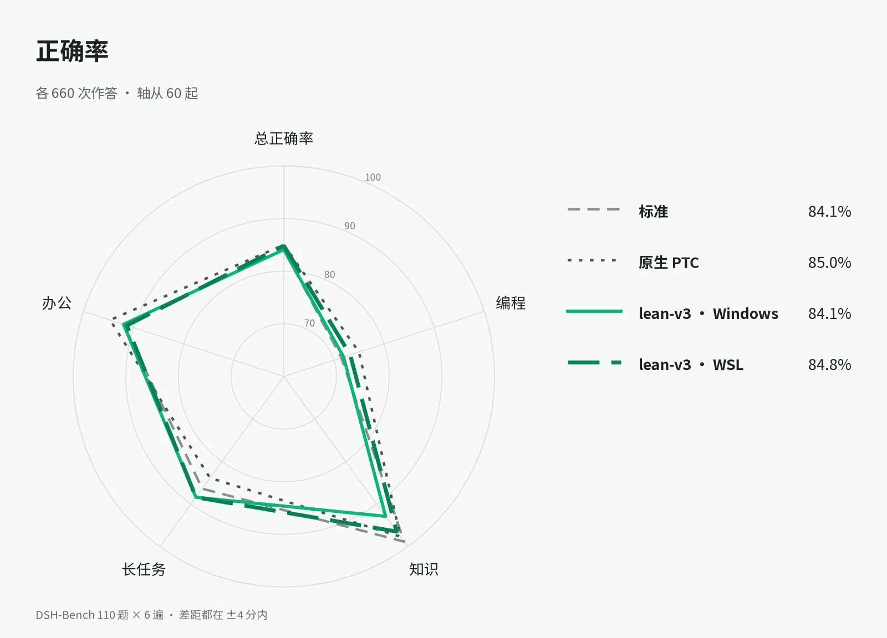
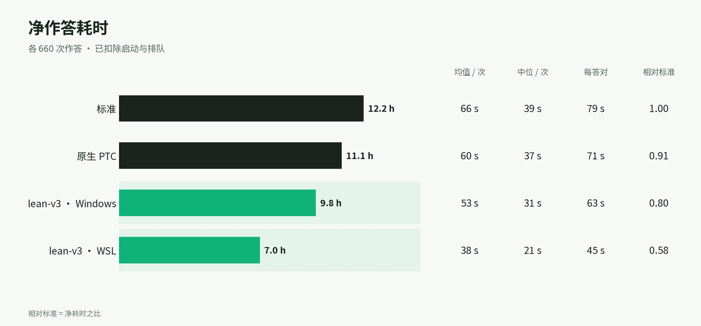
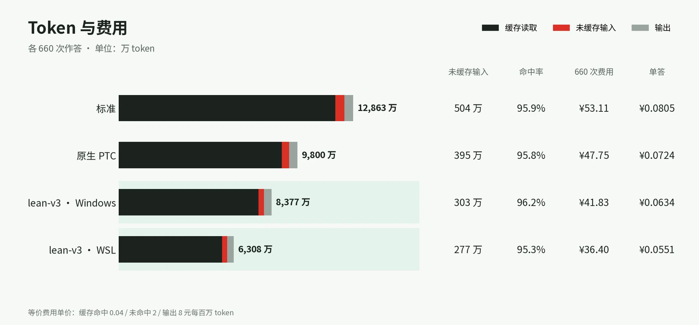

# 基准：DSH-Bench 110 题 × 6 遍（四臂对比 · 2026-11-17）

> **一句话**：同一套题、同一模型、同一题序下，换 lean-v3 **不掉正确率**（五个维度差距都在 ±4 分内），
> 但 **token 少 35%、费用少 21%、净作答耗时少 20%**（Windows 一组；WSL 一组更低）。
> 相对「原生 PTC」工具面（把工具面之外的差异都排除掉），token 再少约 14.5%（Windows）。

## 1. 口径

| 项 | 值 |
|---|---|
| 题量 | 110 题 × 6 遍 = **每臂 660 次作答**（四臂共 2,640 次） |
| 臂 | 标准（出厂 `standard`）· 原生 PTC（出厂 `ptc`）· lean-v3 · Windows · lean-v3 · WSL |
| 耗时口径 | **净作答耗时**，已扣除启动与排队 |
| 费用口径 | 等价单价折算：缓存命中 0.04 / 未命中 2 / 输出 8 元每百万 token（不取面板里的美元数） |
| 判分 | 全客观（选择题、整数题、文件核对、隐藏单元测试、多步检查项），不请大模型当裁判 |
| 正确率轴 | 图上的轴**从 60 起**，避免把几分的差距看成悬殊 |

## 2. 正确率：掉没掉点

| 配置 | 总正确率 | 与标准之差 |
|---|---:|---:|
| 标准 | 84.1% | — |
| 原生 PTC | 85.0% | +0.9 分 |
| lean-v3 · Windows | 84.1% | ±0.0 分 |
| lean-v3 · WSL | 84.8% | +0.7 分 |

五个维度（总正确率 / 编程 / 知识 / 长任务 / 办公）**差距都在 ±4 分内**，没有哪个维度出现「省 token 换来掉点」的形态。
需要如实说明的是：0.1 分级的差异本身在噪声内，这份截面的结论只能是「**没有可测出的下降**」，不是「变强了」。

## 3. 净作答耗时

| 配置 | 净耗时 | 均值/次 | 中位/次 | 每答对 | 相对标准 |
|---|---:|---:|---:|---:|---:|
| 标准 | 12.2 h | 66 s | 39 s | 79 s | 1.00 |
| 原生 PTC | 11.1 h | 60 s | 37 s | 71 s | 0.91 |
| lean-v3 · Windows | 9.8 h | 53 s | 31 s | 63 s | 0.80 |
| lean-v3 · WSL | 7.0 h | 38 s | 21 s | 45 s | 0.58 |

按图上数字折算：原生 PTC **−9.0%**、lean-v3 Windows **−19.7%**、lean-v3 WSL **−42.6%**。
「每答对耗时」把正确率也算进去了，所以它比总耗时更能反映真实成本：79 s → 63 s → 45 s。

## 4. Token 与费用

| 配置 | 总 token | 未缓存输入 | 命中率 | 660 次费用 | 单答费用 |
|---|---:|---:|---:|---:|---:|
| 标准 | 12,863 万 | 504 万 | 95.9% | ¥53.11 | ¥0.0805 |
| 原生 PTC | 9,800 万 | 395 万 | 95.8% | ¥47.75 | ¥0.0724 |
| lean-v3 · Windows | 8,377 万 | 303 万 | 96.2% | ¥41.83 | ¥0.0634 |
| lean-v3 · WSL | 6,308 万 | 277 万 | 95.3% | ¥36.40 | ¥0.0551 |

按图上数字折算（相对标准）：token **−23.8% / −34.9% / −51.0%**，费用 **−10.1% / −21.2% / −31.5%**。
四臂命中率都在 95.3–96.2%，差别很小 —— 也就是说，省下来的不是「缓存运气」，而是**未缓存输入与输出本身变少了**（504 万 → 303 万 → 277 万）。

## 5. 三个容易读错的点

1. **Windows 与 WSL 不是两个预设。** 两列跑的是同一份规则、同一台机器、同一模型与题序，差别在运行环境（启动方式、文件系统、并发调度）。所以正文引用时用**更保守的 Windows 一列**；WSL 那一列可以看作「同一份规则在更顺的环境里能做到多少」。
2. **和「原生 PTC」比才是预设的净效果。** 和「标准」比会同时算进 PTC 工具面的收益：token 上 Windows 一列是 −34.9%（相对标准）、−14.5%（相对原生 PTC，8377 / 9800）；WSL 一列是 −51.0% / −35.6%（6308 / 9800）。
3. **正确率是四舍五入到 0.1 分的。** 看到 84.1% vs 84.1% 不代表逐题完全一致；要看的是「有没有超出 ±4 分的差」。

## 6. 题目集不一样，别跨集比较

这三张图的题**不是** [`dsh-bench`](https://github.com/LarryE135/dsh-bench) 仓库 v1 定版的那 160 题，也不是本仓库 README 里那次 `n = 3` 的小样本：

| 来源 | 题目集 | 臂与统计 | 能横向比吗 |
|---|---|---|---|
| **本文** | DSH-Bench **110 题 × 6 遍**（每臂 660 次） | 四臂（标准 / 原生 PTC / lean-v3 ×2 环境），配对同题序 | 本页内部可比 |
| [`dsh-bench`](https://github.com/LarryE135/dsh-bench) 仓库 v1 | **160 题（104 主测 + 56 候补）**，另有 8 道 C-Eval 只披露题号 | 默认 `std` / `ptc` 两臂，配对 bootstrap + McNemar | **不可**与本文直接对齐（题量、统计方法都不同） |
| 本仓库 README 里 `n = 3、7 项验收` | 3 题 × 7 项验收 | 两档（full / light） | 不可（更早的小样本） |

（本仓库另有 `benchmarks/office/` 办公数据处理专项集，题量与样本都不同，同样不参与横比。）

结论：**只能在同一套题内看臂间差**（同题序、同随机污染、只换工具面/预设）。跨题集比绝对值没有意义，
这也是本页不写「我们的正确率比某某高多少」的原因。

## 7. 复现

- 跑法、配置、判分器、臂的写法都在 [`dsh-bench`](https://github.com/LarryE135/dsh-bench)（`config.example.json` 的 `arms` 里加一条 lean-v3 臂即可；本文的 lean-v3 两臂就是把 `flash-lean-ptc-v3` 作为该臂的 preset）
- Windows 用 `run.bat`、WSL 用 `./run.sh`，两边的差异就是本页 Windows / WSL 两列
- 逐题明细与原始会话记录不在本仓库：这里只放汇总截面，避免把 bench 数据塞进预设包

> 相关：[省 token 的四条机制](技术文档-省token四机制.md) · [实测证据](实测证据.md)
